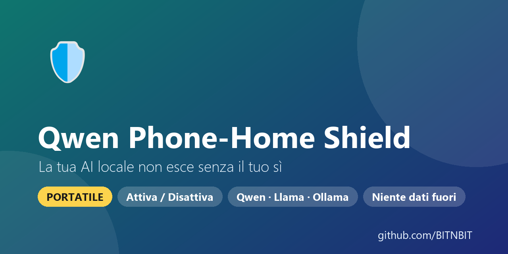
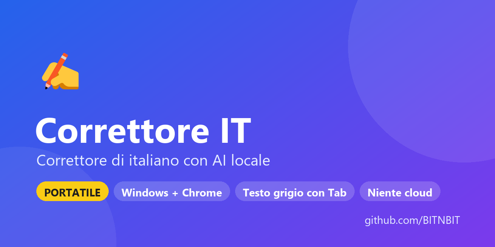
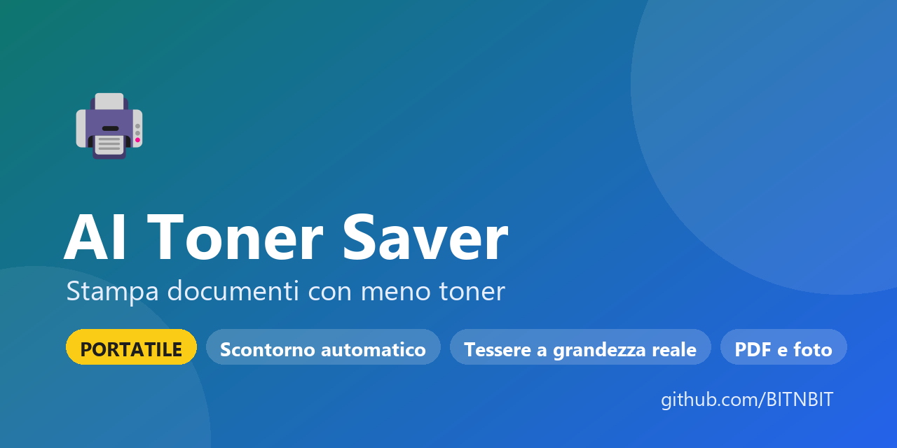
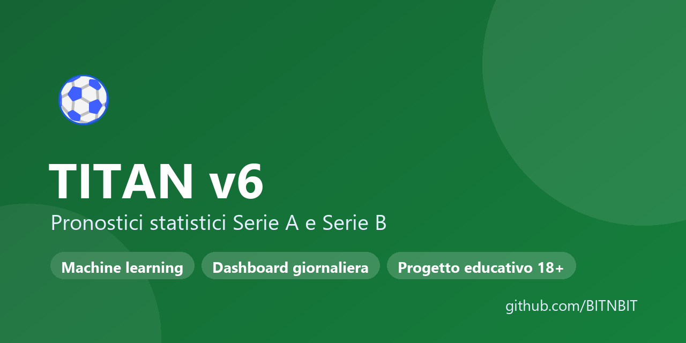

# Ciao, sono BITNBIT 👋

Creo **programmi gratuiti e open source per Windows**, in italiano, che funzionano **sul tuo PC**:
niente cloud, niente abbonamenti, spesso niente installazione (**portatili**: vivono in una cartella).

☕ [Offrimi un caffè](https://buymeacoffee.com/bitnbit) · ▶️ [YouTube @bitnbit](https://www.youtube.com/@bitnbit) · 🌐 [bitnbit.com](https://bitnbit.com)

## Progetti

### 🛡️ [Qwen Phone-Home Shield](https://github.com/BITNBIT/qwen-phonehome-shield) — la tua AI locale non esce senza il tuo sì · *portatile*
Quando un'AI locale (Qwen, Llama, Ornith… con llama.cpp, Ollama, LM Studio o un agente) prova a collegarsi a internet,
una finestra ti dice **quale modello** e **verso quale sito**: **Accetta solo ora**, **Accetta sempre**, **No**, **No, mai**.
Blocca gli indirizzi dell'incidente Qwen3.8 (upload verso Alibaba Cloud a Pechino). Si attiva e disattiva con un doppio clic, **nessun dato inviato**.
`PowerShell` `Windows Firewall` `privacy` · [Scarica](https://github.com/BITNBIT/qwen-phonehome-shield/releases/latest)

### ✍️ [Correttore IT](https://github.com/BITNBIT/correttore-it) — correttore di italiano con AI locale · *portatile*
Corregge ortografia e grammatica in **qualsiasi programma di Windows** (Ctrl+Maiusc+Spazio) e in **Chrome**,
suggerisce il seguito della frase mentre scrivi (Tab), scrive risposte, riscrive e traduce.
L'AI (llama.cpp + Qwen3.5) gira sul PC: **il testo non esce mai dal computer**.
`C#` `llama.cpp` `Chrome extension` · [Scarica](https://github.com/BITNBIT/correttore-it/releases/latest)

### 🖨️ [AI Toner Saver](https://github.com/BITNBIT/ai-toner-saver) — stampa documenti consumando meno toner · *portatile*
Pulisce PDF e foto del telefono per la stampa in bianco e nero: **scontorno automatico** del foglio,
fondo grigio rimosso, **carta d'identità e patente a grandezza reale** fronte/retro su un foglio, cartella automatica.
`Python` `OpenCV` `PySide6` · [Scarica](https://github.com/BITNBIT/ai-toner-saver/releases/latest)

### ⚽ [Pronostic-python (TITAN v6)](https://github.com/BITNBIT/Pronostic-python) — pronostici statistici Serie A e Serie B
Sistema automatico che ogni giorno aggiorna dati, rating Elo e modelli (LightGBM, Poisson, Dixon-Coles)
e pubblica la [dashboard](https://bitnbit.github.io/Pronostic-python/) con la verifica dei pronostici passati. Progetto educativo, vietato ai minori di 18 anni.
`Python` `machine learning` `GitHub Actions`

---

*Free, open-source Windows tools in Italian that run locally: a guard that stops local AI from going online without your OK (Qwen Phone-Home Shield), a private AI proofreader (Correttore IT),
a toner-saving document cleaner (AI Toner Saver) and a Serie A / Serie B statistics model (TITAN).*

Se un programma ti è utile, lascia una ⭐ al progetto: aiuta altre persone a trovarlo.
